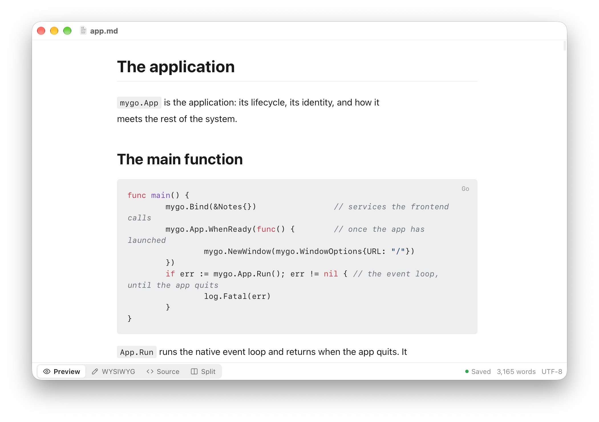

<p align="center">
  
</p>

<h1 align="center">LiteMd</h1>

<p align="center">
  一个文件，一个窗口，所见即所得，原文不走样。<br>
  轻量的桌面 Markdown 编辑器，macOS / Windows / Linux。
</p>

<p align="center">
  <a href="https://github.com/jorben/litemd/actions/workflows/ci.yml"></a>
  <a href="LICENSE"></a>
  <a href="https://github.com/jorben/litemd/releases"></a>
</p>

<p align="center"><a href="#english">English</a></p>

<p align="center">
  
</p>

## 为什么用 LiteMd

- **双击就打开**：在访达或资源管理器里双击 `.md`，每个文件一个独立窗口，冷启动不到 1 秒；默认以预览打开，`⌘E` 或双击正文进入编辑。
- **不改你没动过的地方**：只打开不编辑，文件一个字节都不会变；改了一处，保存时只重写那一块，其余的空行、列表符号、表格对齐原样保留。每次构建都会对 260 多份真实文档做回归测试。
- **四种查看方式**：预览、所见即所得、源码（CodeMirror）、分屏，`⌘1`–`⌘4` 切换，切换时阅读位置不丢。
- **不用操心保存**：已存在的文件自动保存；崩溃后重开能找回未保存的内容；文件被别的程序改了会提示你选择保留哪个版本。
- **常用扩展都能显示**：GFM 表格和任务列表、代码高亮、KaTeX 公式、Mermaid 图、脚注、GitHub 提示块、`<details>`、frontmatter。
- **轻**：基于系统 WebView（[mygo](https://github.com/egoist/mygo)），不打包浏览器，macOS 安装包约 6 MB。没有账号，没有遥测。

## 安装

从 [Releases](https://github.com/jorben/litemd/releases) 下载：

| 平台 | 安装包 | 说明 |
|---|---|---|
| macOS 13+ | `litemd-<版本>-arm64.dmg`（Apple 芯片）与 Intel 版 `.dmg` | 已签名和公证，拖进「应用程序」即可 |
| Windows 10+ | `litemd-setup-<版本>-amd64.exe` | 按用户安装，不需要管理员权限。安装包**没有代码签名**，第一次运行时 SmartScreen 会拦截，点「更多信息 → 仍要运行」 |
| Linux | `.AppImage` / `.deb` | 尽力支持 |

装好后应用会在后台检查更新（可在「设置 → 隐私」关闭），检查时不上传任何个人数据。

### 命令行

```sh
litemd 笔记.md 报告.md      # 每个文件一个窗口；不存在的文件会新建
```

macOS 上在菜单「LiteMd → 安装命令行工具…」把 `litemd` 装到 `/usr/local/bin`；Windows / Linux 上直接运行安装目录里的可执行文件，或把安装目录加入 `PATH`。

## 使用

| 操作 | macOS | Windows / Linux |
|---|---|---|
| 预览 / 所见即所得 / 源码 / 分屏 | `⌘1` `⌘2` `⌘3` `⌘4` | `Ctrl+1`–`Ctrl+4` |
| 在预览与编辑之间切换 | `⌘E` | `Ctrl+E` |
| 查找 / 替换 | `⌘F` / `⌥⌘F` | `Ctrl+F` / `Ctrl+Alt+F` |
| 大纲 | `⇧⌘O` | `Ctrl+Shift+O` |
| 标题 1–6 / 正文 | `⌥⌘1`–`⌥⌘6` / `⌥⌘0` | `Ctrl+Alt+1`–`6` / `Ctrl+Alt+0` |

完整列表见 [docs/keybindings.md](docs/keybindings.md)。粘贴或拖入的图片默认保存到文档旁边的 `assets/` 文件夹（可在设置中更改）。

## 从源码构建

需要 Go（`go.mod` 会自动下载所需的 1.27.4 工具链）、Node.js 24 和 pnpm 11。

```sh
pnpm -C frontend install
go tool mygo dev            # 开发：启动 Vite 和应用，前端热更新
go tool mygo build          # 打包到 build/：.app 与 DMG（本机为未签名的 ad-hoc 签名）
```

测试：

```sh
go test -race ./...
pnpm -C frontend typecheck && pnpm -C frontend lint
pnpm -C frontend test       # 单元测试 + 保真回归（testdata/fidelity/）
```

修改 Go 服务后运行 `go tool mygo generate` 更新 `frontend/src/mygo.ts`；修改菜单快捷键后运行
`LITEMD_UPDATE_GOLDEN=1 go test ./internal/menu` 更新快捷键表和文档。

## 项目结构

```text
main.go               应用入口：窗口、菜单、服务绑定
internal/             Go：文档会话与同步、编码、图片协议、链接、设置、菜单、导出、更新
frontend/src/shell/   页面外壳：状态栏、提示条、查找、大纲、设置窗口、导出
frontend/src/editor/  所见即所得（Tiptap）与源码（CodeMirror）编辑器
frontend/src/fidelity/ 保真写回：只重写改动过的顶层块
frontend/src/vmark/   从 vmark 迁入的 Markdown 管线与编辑器扩展
testdata/fidelity/    保真回归语料
```

设计与验收文档：[产品需求](docs/product-requirements.md) · [技术方案](docs/technical-design.md) ·
[交互原型](docs/prototype.html) · [M0 技术验证](docs/m0-report.md) · [性能报告](docs/perf-report.md) ·
[v1 验收清单](docs/v1-acceptance.md)

## 许可

[Apache-2.0](LICENSE)。Markdown 管线和编辑器扩展迁自 [vmark](https://github.com/xiaolai/vmark)（ISC），第三方代码清单见 [THIRD_PARTY.md](THIRD_PARTY.md)。

---

<a id="english"></a>

## English

LiteMd is a lightweight desktop Markdown editor: double-click a `.md` file and it opens in its own window
in under a second, in a preview you can switch to WYSIWYG, source or split view (`⌘1`–`⌘4`).
It autosaves, recovers unsaved changes after a crash, and never rewrites what you didn't touch:
opening and saving leaves the file byte-identical, and an edit rewrites only the block you changed.
Built on the system WebView with [mygo](https://github.com/egoist/mygo); no account, no telemetry.
The interface is available in English and Simplified Chinese (Settings → General → Language).

Download from [Releases](https://github.com/jorben/litemd/releases). The Windows installer isn't code-signed:
when SmartScreen stops it, choose “More info → Run anyway”. Build from source with
`pnpm -C frontend install && go tool mygo build`. Licensed under Apache-2.0.
