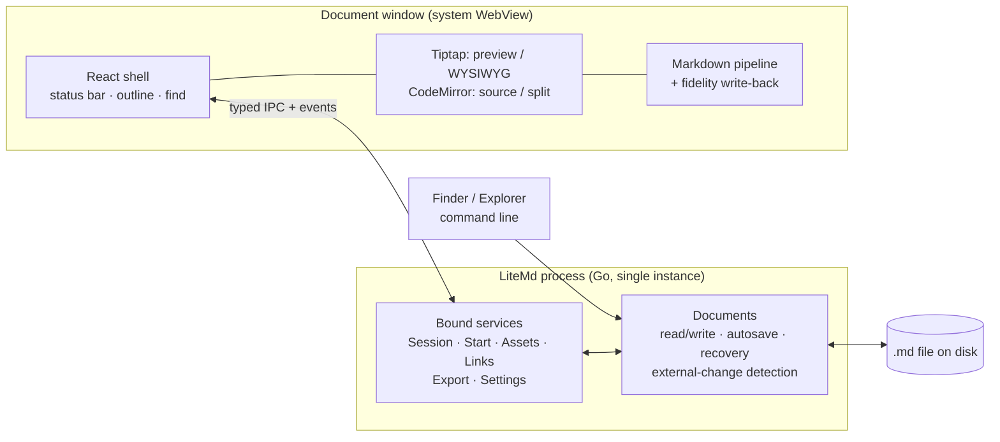

<div align="center">


# LiteMd

**One file, one window. Light, handy, and gone when you're done.**

[](https://github.com/jorben/litemd/actions/workflows/ci.yml)
[](https://github.com/jorben/litemd/releases)
[](#requirements)
[](go.mod)
[](LICENSE)

**English** | [简体中文](README.zh-CN.md)


</div>

LiteMd is a lightweight desktop Markdown editor for macOS, Windows and Linux.
It treats `.md` files the way an image viewer treats pictures: double-click
one and it opens in its own window. There is no file tree, no notes library
and no tabs, and saving never rewrites the parts of the file you didn't edit.

> [!IMPORTANT]
> **Early release.** 0.1.0 is the first stable release. Expect rough edges,
> and keep important documents under version control or backed up.

## Highlights

- **Opens on double-click.** Double-click a `.md` file in Finder or Explorer
  and it gets its own window. Median cold start to rendered content is about
  0.65 s ([performance report](docs/perf-report.md), in Chinese). Files open
  in preview; press `⌘E` or double-click the text to start editing. Launched
  without a file, LiteMd shows a small start window with your recent files.
- **Leaves what you didn't touch alone.** Open a file without editing it and
  not a single byte changes. Edit one block and saving rewrites only that
  block: blank lines, list markers, table alignment and line endings elsewhere
  stay as they were. Every build runs a fidelity regression suite over 260+
  real-world documents (`testdata/fidelity/`).
- **Four views.** Preview, WYSIWYG, source (CodeMirror) and split view.
  Switch with `⌘1`–`⌘4` and keep your reading position.
- **No save anxiety.** Existing files autosave. After a crash, unsaved
  changes come back when you reopen the file. If another program changes the
  file while you're editing, LiteMd asks which version to keep.
- **Renders the extensions you use.** GFM tables and task lists, syntax
  highlighting, KaTeX math, Mermaid diagrams, footnotes, GitHub alerts,
  `<details>` and frontmatter. Export to HTML or PDF, or print.
- **Light and private.** LiteMd uses the system WebView through
  [mygo](https://github.com/egoist/mygo) instead of bundling a browser, so the
  macOS DMG is about 7 MB. No account and no telemetry. The interface is
  available in English and Simplified Chinese.

## Requirements

| Platform | Supported |
| --- | --- |
| macOS | 13 Ventura or later, Apple silicon or Intel |
| Windows | 10 or later, x64 |
| Linux | x64 or arm64 (best-effort support) |

To [build from source](#build-from-source) you also need Go (`go.mod` fetches
the required 1.27.4 toolchain automatically), Node.js 24 (see `.nvmrc`) and
pnpm 11.

## Getting Started

### 1. Install

Download the package for your platform from the
[latest release](https://github.com/jorben/litemd/releases/latest):

| Platform | Package | Notes |
| --- | --- | --- |
| macOS | `litemd-<version>-arm64.dmg` (Apple silicon)<br>`litemd-<version>-amd64.dmg` (Intel) | Signed with a Developer ID and notarized. Drag LiteMd into Applications |
| Windows | `litemd-setup-<version>-amd64.exe` | Per-user install, no admin rights needed |
| Linux | `.deb` / `.rpm` / `.tar.gz` (amd64 and arm64) | |

Every release also ships a `SHA256SUMS` file. To check a download, compare
the output of `shasum -a 256 <file>` (or `sha256sum <file>` on Linux) with the
matching line in it.

<details>
<summary><strong>One-line install script</strong></summary>

Each release includes an install script that installs LiteMd for the current
user without admin rights. On macOS it checks the update signature and
installs into `/Applications` (or `~/Applications`); on Linux it installs into
`~/.local` and adds a menu entry.

```sh
# macOS / Linux
curl -fsSL https://github.com/jorben/litemd/releases/latest/download/install.sh | sh
```

```powershell
# Windows (PowerShell)
irm https://github.com/jorben/litemd/releases/latest/download/install.ps1 | iex
```

Read a script before you pipe it into a shell. `sh install.sh --uninstall`
removes what it installed.

</details>

> [!WARNING]
> The Windows installer is **not code-signed**. On first run SmartScreen will
> block it. Choose **More info → Run anyway**. Auto-updates still verify the
> update signature.

### 2. Open a file

Double-click any `.md`, `.markdown`, `.mdown` or `.mkd` file, drop one onto
the start window, or use the command line:

```sh
litemd notes.md report.md   # one window per file; missing files are created
```

On macOS, choose **LiteMd → Install Command Line Tool…** to put `litemd` in
`/usr/local/bin`. On Windows and Linux, run the executable in the install
directory or add that directory to your `PATH`.

| Action | macOS | Windows / Linux |
| --- | --- | --- |
| Preview / WYSIWYG / Source / Split | `⌘1` `⌘2` `⌘3` `⌘4` | `Ctrl+1`–`Ctrl+4` |
| Toggle between preview and editing | `⌘E` | `Ctrl+E` |
| Find / Replace | `⌘F` / `⌥⌘F` | `Ctrl+F` / `Ctrl+Alt+F` |
| Outline | `⇧⌘O` | `Ctrl+Shift+O` |
| Heading 1–6 / Body text | `⌥⌘1`–`⌥⌘6` / `⌥⌘0` | `Ctrl+Alt+1`–`6` / `Ctrl+Alt+0` |

The full list is in [docs/keybindings.md](docs/keybindings.md) (in Chinese).

> [!TIP]
> Pasted or dropped images go into an `assets/` folder next to the document.
> Change this in **Settings → Editing**. To switch the interface language, go
> to **Settings → General → Language**; it takes effect after a restart.

### 3. Stay up to date

LiteMd checks for updates in the background and verifies each update's
signature before installing it. No personal data is sent when checking. Turn
automatic checks off in **Settings → Privacy**, or check by hand with
**Check for Updates…**.

## How It Works



The Markdown text is the only source of truth. Reading, writing, autosave,
crash recovery and external-change detection all live on the Go side. The
page holds the editing state and pushes text to Go **only after you actually
edit**, tagging every push with a sequence number so a stale push can never
overwrite a newer one. Before saving, the fidelity layer compares the editor
document with a baseline of the original source and rewrites only the
top-level blocks that changed. The page can only reach the disk through a few
services scoped to its own document. For the full design, see the
[technical design](docs/technical-design.md) (in Chinese).

## Development

### Build from source

```sh
git clone https://github.com/jorben/litemd.git
cd litemd
make dev
```

`make dev` installs the frontend dependencies, starts Vite and launches
**LiteMd Dev** (with a Dev badge on its icon) with hot reload. Extra mygo
flags go through `ARGS`, for example `make dev ARGS="-lang en"` or
`make build ARGS="-platform windows/amd64"`.

### Commands

| Command | What it does |
| --- | --- |
| `make dev` | Start Vite and the LiteMd Dev app with hot reload |
| `make build` | Package into `build/`: `.app` and DMG (ad-hoc signed for local builds) |
| `make build-app` | Package only the `.app`, skipping the DMG |
| `make check` | Same checks as CI: lint, Go tests, bindings check, typecheck, frontend tests |
| `make test` | Go tests (with `-race`) plus frontend unit tests and fidelity regression |
| `make generate` | Regenerate `frontend/src/mygo.ts` after changing a Go service |
| `make golden` | Update the shortcut table and docs after changing menu shortcuts |
| `make icon` | Regenerate the release, Dev and web icons from `docs/images/icon-source.png` |
| `make clean` | Remove `build/`, `.mygo/`, `frontend/dist/` and test builds |

Run `make` with no target to list them all.

<details>
<summary><strong>Without Make</strong></summary>

```sh
pnpm -C frontend install
go tool mygo dev
go tool mygo build
go test -race ./...
pnpm -C frontend typecheck && pnpm -C frontend lint
pnpm -C frontend test       # unit tests + fidelity regression (testdata/fidelity/)
```

</details>

<details>
<summary><strong>macOS smoke and performance tests</strong></summary>

Both targets need `mygo-automation` (shipped with the `mygo-cli` npm package)
on your `PATH`.

| Command | What it does |
| --- | --- |
| `make smoke` | Build with the automation plugin and run the macOS smoke checklist ([`scripts/smoke-macos.sh`](scripts/smoke-macos.sh)) |
| `make perf` | Build a `-debug` automation build and measure cold start, memory, input latency and package size ([`scripts/perf.py`](scripts/perf.py), results in [docs/perf-report.md](docs/perf-report.md)) |

</details>

<details>
<summary><strong>Releases</strong></summary>

Pushing a `vX.Y.Z` tag (optionally with a suffix such as `-rc.1`) runs
[`build.yml`](.github/workflows/build.yml): it generates release notes from
Conventional Commits, builds all three platforms, signs and notarizes the
macOS builds, signs the update packages and publishes a **prerelease**. A
prerelease never becomes `latest`, so installed apps don't update to it until
it is promoted:

```sh
gh release edit vX.Y.Z --prerelease=false --latest
```

The version comes from the tag (`v1.2.0` → `LITEMD_VERSION=1.2.0`, read by
[`mygo.config.ts`](mygo.config.ts)).

</details>

<details>
<summary><strong>Repository layout</strong></summary>

```text
main.go                 App entry: windows, menus, service bindings
internal/               Go: document sessions and sync, start window, CLI, image
                        protocol, links, settings, menus, export, updates, localization
frontend/src/shell/     Page shell: status bar, banners, find, outline, settings, export
frontend/src/editor/    WYSIWYG (Tiptap) and source (CodeMirror) editors
frontend/src/fidelity/  Fidelity write-back: rewrites only the top-level blocks you changed
frontend/src/sync/      Page ⇄ Go content sync with sequence numbers
frontend/src/vmark/     Markdown pipeline and editor extensions ported from vmark
testdata/fidelity/      Fidelity regression corpus (stored byte for byte)
scripts/                Icon generator, macOS smoke checklist, performance measurement
.github/workflows/      CI, release builds and changelog generation
docs/                   Product requirements, technical design, prototype, reports
```

</details>

## Documentation

The design documents in [`docs/`](docs/) are written in Chinese.

- [Product requirements](docs/product-requirements.md): scope, features and
  acceptance criteria
- [Technical design](docs/technical-design.md): process model, content sync
  and the fidelity write-back layer
- [Interactive prototype](docs/prototype.html): a single offline HTML file
- [M0 validation](docs/m0-report.md) and
  [performance report](docs/perf-report.md)
- [v1 acceptance checklist](docs/v1-acceptance.md)
- [Keybindings](docs/keybindings.md)

## Contributing

Issues and pull requests are welcome. Before you open a PR, add focused tests
for the behaviour you change and run `make check`. Files under
`testdata/fidelity/` are stored byte for byte (trailing spaces and CRLF
included), so don't let your editor reformat them. Commits follow Conventional
Commits with gitmoji, such as `fix(ui): 🐛 ...`.

## License

LiteMd is licensed under the [Apache License 2.0](LICENSE). The Markdown
pipeline and editor extensions are ported from
[vmark](https://github.com/xiaolai/vmark) (ISC). See
[THIRD_PARTY.md](THIRD_PARTY.md) for third-party code.
