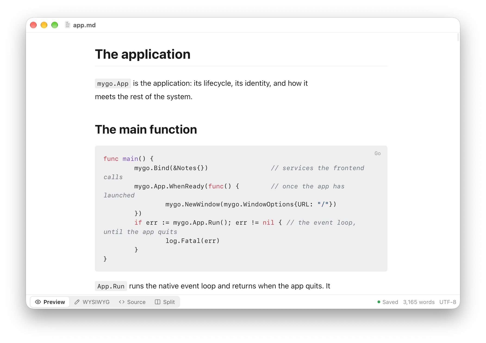
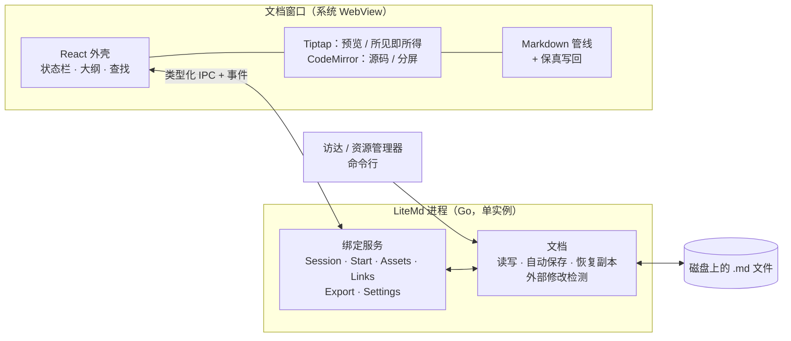

<div align="center">


# LiteMd

**一个文件，一个窗口，轻量便捷，用完即走。**

[](https://github.com/jorben/litemd/actions/workflows/ci.yml)
[](https://github.com/jorben/litemd/releases)
[](#系统要求)
[](go.mod)
[](LICENSE)
<a href="https://awesomemygo.dev/apps/litemd"></a>

[English](README.md) | **简体中文**



</div>

LiteMd 是一款轻量的桌面 Markdown 编辑器，支持 macOS、Windows 和 Linux。它像图片查看器一样对待
`.md` 文件：双击打开，每个文件一个独立窗口。没有文件树、笔记库和标签页，保存时也不会改动你没编辑过的部分。

> [!IMPORTANT]
> **早期版本**：0.1.0 是第一个正式版，难免还有粗糙之处。重要文档请放在版本控制里或做好备份。

## 亮点

- **双击就打开**：在访达或资源管理器里双击 `.md`，每个文件一个窗口；冷启动到显示内容的中位耗时约
  0.65 秒（[性能报告](docs/perf-report.md)）。默认以预览打开，`⌘E` 或双击正文进入编辑。不带文件启动时，
  会显示一个列出最近文件的小启动窗口。
- **不改你没动过的地方**：只打开不编辑，文件一个字节都不会变；改了一处，保存时只重写那一块，其余的空行、
  列表符号、表格对齐、换行符原样保留。每次构建都会用 260 多份真实文档做保真回归测试（`testdata/fidelity/`）。
- **四种查看方式**：预览、所见即所得、源码（CodeMirror）、分屏，`⌘1`–`⌘4` 切换，切换时阅读位置不丢。
- **不用操心保存**：已存在的文件自动保存；崩溃后重开能找回未保存的内容；编辑时文件被别的程序改了，
  会提示你选择保留哪个版本。
- **常用扩展都能显示**：GFM 表格和任务列表、代码高亮、KaTeX 公式、Mermaid 图、脚注、GitHub 提示块、
  `<details>`、frontmatter。还可以导出 HTML / PDF 或直接打印。
- **轻，且不收集数据**：基于系统 WebView（[mygo](https://github.com/egoist/mygo)），不打包浏览器，
  macOS 安装包约 7 MB。没有账号，没有遥测；界面支持简体中文和 English。

## 系统要求

| 平台 | 支持范围 |
| --- | --- |
| macOS | 13 Ventura 及以上，Apple 芯片或 Intel |
| Windows | 10 及以上，x64 |
| Linux | x64 或 arm64（尽力支持） |

[从源码构建](#从源码构建)还需要 Go（`go.mod` 会自动下载所需的 1.27.4 工具链）、Node.js 24（见 `.nvmrc`）和 pnpm 11。

## 快速开始

### 1. 安装

从[最新版本](https://github.com/jorben/litemd/releases/latest)下载对应平台的安装包：

| 平台 | 安装包 | 说明 |
| --- | --- | --- |
| macOS | `litemd-<版本>-arm64.dmg`（Apple 芯片）<br>`litemd-<版本>-amd64.dmg`（Intel） | 已用 Developer ID 签名并经过公证，拖进「应用程序」即可 |
| Windows | `litemd-setup-<版本>-amd64.exe` | 按用户安装，不需要管理员权限 |
| Linux | `.deb` / `.rpm` / `.tar.gz`（amd64 与 arm64） | |

每个版本都附带 `SHA256SUMS` 文件。校验下载时，把 `shasum -a 256 <文件>`（Linux 上为 `sha256sum <文件>`）
的输出与其中对应的一行比对即可。

<details>
<summary><strong>一行命令安装</strong></summary>

每个版本都带有安装脚本，为当前用户安装 LiteMd，不需要管理员权限。macOS 上会校验更新签名，装到
`/Applications`（无写权限时为 `~/Applications`）；Linux 上装到 `~/.local` 并添加应用菜单项。

```sh
# macOS / Linux
curl -fsSL https://github.com/jorben/litemd/releases/latest/download/install.sh | sh
```

```powershell
# Windows（PowerShell）
irm https://github.com/jorben/litemd/releases/latest/download/install.ps1 | iex
```

把脚本交给 shell 执行之前请先看一遍。`sh install.sh --uninstall` 可卸载它装的内容。

</details>

> [!WARNING]
> Windows 安装包**没有代码签名**，第一次运行时 SmartScreen 会拦截，点「更多信息 → 仍要运行」。
> 自动更新下载的安装包仍会校验更新签名。

### 2. 打开文件

双击任意 `.md`、`.markdown`、`.mdown`、`.mkd` 文件，把文件拖到启动窗口，或者用命令行：

```sh
litemd 笔记.md 报告.md      # 每个文件一个窗口；不存在的文件会新建
```

macOS 上通过菜单「LiteMd → 安装命令行工具…」把 `litemd` 装到 `/usr/local/bin`；Windows / Linux
上直接运行安装目录里的可执行文件，或把安装目录加入 `PATH`。

| 操作 | macOS | Windows / Linux |
| --- | --- | --- |
| 预览 / 所见即所得 / 源码 / 分屏 | `⌘1` `⌘2` `⌘3` `⌘4` | `Ctrl+1`–`Ctrl+4` |
| 在预览与编辑之间切换 | `⌘E` | `Ctrl+E` |
| 查找 / 替换 | `⌘F` / `⌥⌘F` | `Ctrl+F` / `Ctrl+Alt+F` |
| 大纲 | `⇧⌘O` | `Ctrl+Shift+O` |
| 标题 1–6 / 正文 | `⌥⌘1`–`⌥⌘6` / `⌥⌘0` | `Ctrl+Alt+1`–`6` / `Ctrl+Alt+0` |

完整列表见 [docs/keybindings.md](docs/keybindings.md)。

> [!TIP]
> 粘贴或拖入的图片默认保存到文档旁边的 `assets/` 文件夹，可在「设置 → 编辑」中更改。
> 界面语言在「设置 → 通用 → 界面语言」中切换，重启后生效。

### 3. 保持更新

LiteMd 会在后台检查更新，安装前校验更新包的签名，检查时不上传任何个人数据。可在「设置 → 隐私」
关闭自动检查，或通过「检查更新…」手动检查。

## 工作原理



Markdown 文本是唯一的真实数据。读写盘、自动保存、崩溃恢复和外部修改检测都在 Go 侧完成。页面持有编辑状态，
**只在你确实编辑之后**才把文本推给 Go，每次推送都带序号，旧内容永远不会覆盖新内容。保存前，保真层把编辑器文档与原文基线比对，
只重写改动过的顶层块。页面只能通过少数几个按本窗口文档限定作用域的服务影响磁盘。完整设计见
[技术方案](docs/technical-design.md)。

## 开发

### 从源码构建

```sh
git clone https://github.com/jorben/litemd.git
cd litemd
make dev
```

`make dev` 会安装前端依赖、启动 Vite，并以热更新方式运行 **LiteMd Dev**（图标带 Dev 徽章）。额外的 mygo
参数通过 `ARGS` 传入，例如 `make dev ARGS="-lang en"` 或 `make build ARGS="-platform windows/amd64"`。

### 常用命令

| 命令 | 作用 |
| --- | --- |
| `make dev` | 启动 Vite 和开发版 LiteMd Dev，前端热更新 |
| `make build` | 打包到 `build/`：`.app` 与 DMG（本机构建为 ad-hoc 签名） |
| `make build-app` | 只打包 `.app`，跳过 DMG |
| `make check` | 与 CI 相同的检查：lint、Go 测试、绑定检查、类型检查、前端测试 |
| `make test` | Go 测试（带 `-race`）及前端单元测试与保真回归 |
| `make generate` | 修改 Go 服务后重新生成 `frontend/src/mygo.ts` |
| `make golden` | 修改菜单快捷键后更新快捷键表和文档 |
| `make icon` | 用 `docs/images/icon-source.png` 重新生成正式版、开发版和网页图标 |
| `make notices` | 依赖或 `THIRD_PARTY.md` 变化后，重新生成随应用打包的 `frontend/public/THIRD_PARTY_NOTICES.txt` |
| `make clean` | 删除 `build/`、`.mygo/`、`frontend/dist/` 及测试构建 |

不带参数运行 `make` 可列出全部目标。

<details>
<summary><strong>不用 Make</strong></summary>

```sh
pnpm -C frontend install
go tool mygo dev
go tool mygo build
go test -race ./...
pnpm -C frontend typecheck && pnpm -C frontend lint
pnpm -C frontend test       # 单元测试 + 保真回归（testdata/fidelity/）
```

</details>

<details>
<summary><strong>macOS 冒烟与性能测试</strong></summary>

两个目标都需要 `PATH` 中有 `mygo-automation`（npm 包 `mygo-cli` 自带）。

| 命令 | 作用 |
| --- | --- |
| `make smoke` | 构建带自动化插件的版本并运行 macOS 冒烟清单（[`scripts/smoke-macos.sh`](scripts/smoke-macos.sh)） |
| `make perf` | 构建 `-debug` 自动化版本，测量冷启动、内存、输入延迟和安装包大小（[`scripts/perf.py`](scripts/perf.py)，结果见[性能报告](docs/perf-report.md)） |

</details>

<details>
<summary><strong>发布</strong></summary>

推送 `vX.Y.Z` 形式的 tag（可带 `-rc.1` 这类后缀）会触发 [`build.yml`](.github/workflows/build.yml)：
根据 Conventional Commits 生成更新说明，三个平台同时构建，macOS 版签名并公证，更新包签名，然后发布为
**prerelease**。prerelease 不会成为 `latest`，已安装的应用不会更新到它，验证无误后手动转正：

```sh
gh release edit vX.Y.Z --prerelease=false --latest
```

版本号来自 tag（`v1.2.0` → `LITEMD_VERSION=1.2.0`，由 [`mygo.config.ts`](mygo.config.ts) 读取）。

</details>

<details>
<summary><strong>项目结构</strong></summary>

```text
main.go                 应用入口：窗口、菜单、服务绑定
internal/               Go：文档会话与同步、启动窗口、命令行、图片协议、链接、
                        设置、菜单、导出、更新、本地化
frontend/src/shell/     页面外壳：状态栏、提示条、查找、大纲、设置窗口、导出
frontend/src/editor/    所见即所得（Tiptap）与源码（CodeMirror）编辑器
frontend/src/fidelity/  保真写回：只重写改动过的顶层块
frontend/src/sync/      页面 ⇄ Go 的内容同步（带序号）
frontend/src/vmark/     从 vmark 迁入的 Markdown 管线与编辑器扩展
testdata/fidelity/      保真回归语料（按字节保存）
scripts/                图标生成、macOS 冒烟清单、性能测量
.github/workflows/      CI、发布构建与更新说明生成
docs/                   产品需求、技术方案、交互原型与各类报告
```

</details>

## 文档

- [产品需求](docs/product-requirements.md)：范围、功能与验收标准
- [技术方案](docs/technical-design.md)：进程模型、内容同步与保真写回层
- [交互原型](docs/prototype.html)：单文件离线 HTML
- [M0 技术验证](docs/m0-report.md)与[性能报告](docs/perf-report.md)
- [v1 验收清单](docs/v1-acceptance.md)
- [快捷键](docs/keybindings.md)

## 参与贡献

欢迎提交 Issue 和 Pull Request。提 PR 前请为你改动的行为补上针对性的测试，并运行 `make check`。
`testdata/fidelity/` 下的文件按字节保存（行尾空格、CRLF 都是样例的一部分），不要让编辑器重新格式化它们。
提交信息遵循带 gitmoji 的 Conventional Commits，例如 `fix(ui): 🐛 ...`。

## 许可

LiteMd 以 [Apache License 2.0](LICENSE) 授权。Markdown 管线和编辑器扩展迁自
[vmark](https://github.com/xiaolai/vmark)（ISC），第三方代码清单见 [THIRD_PARTY.md](THIRD_PARTY.md)。
