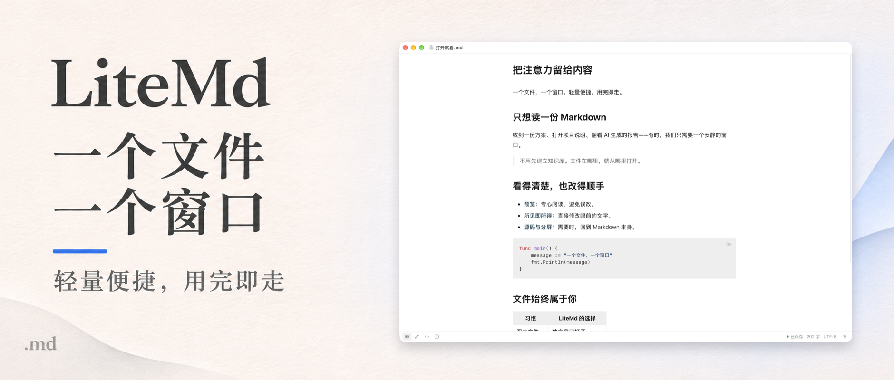
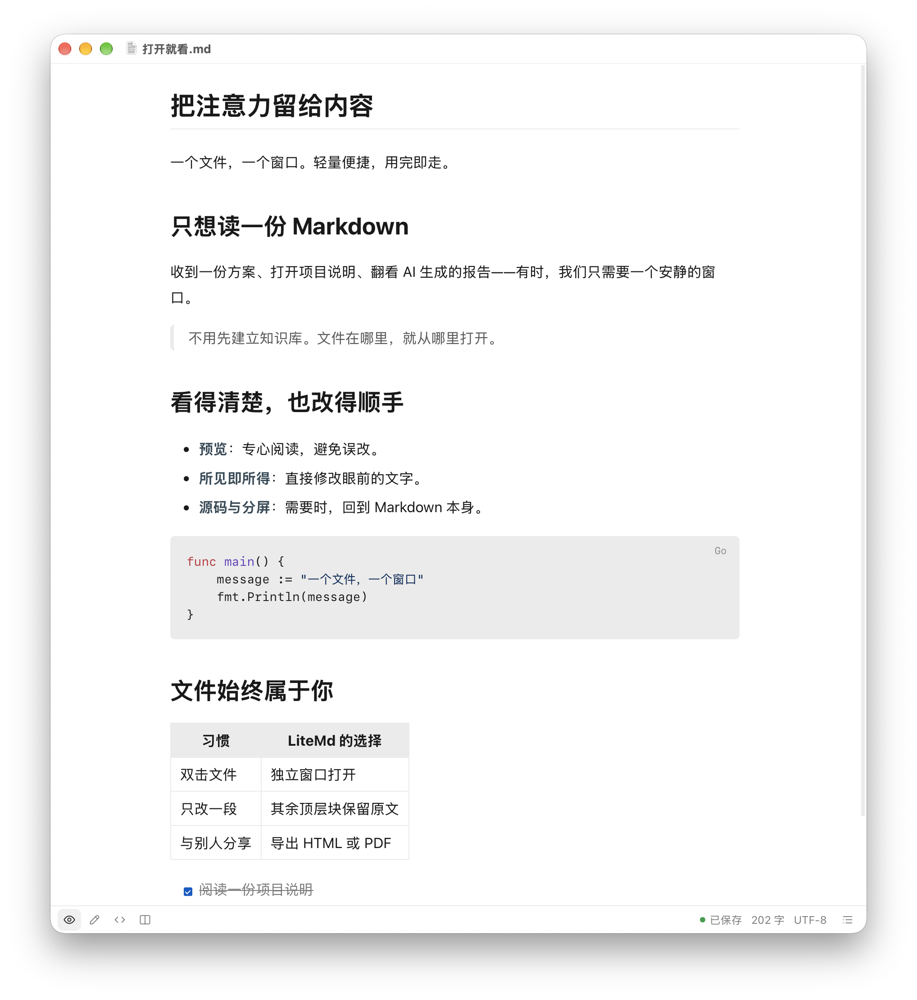
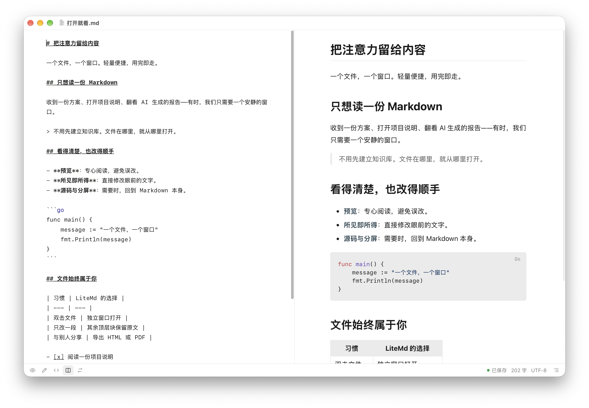

# 我想要一个双击就能看的 Markdown 工具，于是做了 LiteMd

> 摘要：一个文件，一个窗口。双击就能阅读，需要时再编辑。这篇文章聊聊 LiteMd 的初衷和设计取舍。

AI 时代，Markdown 成了越来越常见的内容格式。写代码、读项目文档、整理 AI 生成的报告，我们都会频繁碰到 `.md` 文件。

它可能是仓库里的 `README.md`，可能是一份设计方案，也可能只是别人发来的一段说明。我需要的其实很简单：打开，看一眼，必要时改几句话，然后关掉。

但为这样一个小动作选择工具，反而有些尴尬。

纯文本编辑器能打开，却要在脑子里把标题、表格和链接重新排版。完整的开发环境当然也能胜任，只是有时我并不需要项目、终端和一整套开发工具。以知识管理为中心的软件很适合长期整理笔记，但临时读一个文件，又不一定需要建立知识库。

这些工具各有用处。我想补上的，是那个更小的空缺：**一个像图片查看器一样，随手打开 Markdown 的工具。**

于是，有了 LiteMd。

*实际启动 LiteMd 后的截图。默认以预览模式打开，先把内容呈现出来。*

## 让文件自己成为主角

我对 LiteMd 最初的设想，可以用一句话说清：

**一个文件，一个窗口，轻量便捷，用完即走。**

文件在访达或资源管理器里，就从那里打开；如果你已经用 Git、网盘或自己的目录习惯管理文档，也可以继续照常使用。

LiteMd 不建立笔记库，不提供常驻文件树，也没有标签页。打开多份文档，就得到多个相互独立的窗口。

这些取舍来自同一个问题：临时打开一份文档时，我真正需要什么？

大多数时候，是清楚的正文、顺手的编辑，以及一个随时可以关闭的窗口。

当然，做减法也需要照顾实际使用。空手启动应用时，LiteMd 提供新建、打开和少量最近文件入口。想回到刚才的文档时，不必再去文件夹里找一次。

我希望它的存在感恰到好处：需要时出现，工作完成后退场。

## 先阅读，需要时再动笔

LiteMd 默认以只读预览打开已有文件。

我喜欢这个顺序。很多时候，打开文档只是为了确认一条信息，没有必要一开始就进入可写状态。

要修改时，按 `⌘E` 或双击正文，就能切换到编辑。

LiteMd 一共有四种视图：预览、所见即所得、源码，以及源码与预览并排的分屏，用 `⌘1` 到 `⌘4` 切换。（Windows 和 Linux 把 `⌘` 换成 `Ctrl` 即可。）

*需要检查 Markdown 写法时，切到分屏，边看源码边确认呈现效果。*

我不想替所有人决定哪种编辑方式最好。读报告时，我倾向预览；改正文时，用所见即所得；检查语法或调整细节时，再回到源码。

常见的表格、任务列表、代码高亮，以及数学公式、Mermaid 图表、脚注和 GitHub 提示块，LiteMd 都提供了支持。图片可以粘贴或拖入，默认保存到文档旁的 `assets/` 目录；需要交付给别人时，可以导出 HTML、PDF，或直接打印。

这些功能围绕同一个目的展开：让手头这份文档更容易读、更容易改、更容易分享。

## 轻量，也要把边界说清楚

LiteMd 用 Go 编写，界面直接借用系统自带的网页引擎（WebView）来显示，不在安装包里捆绑一整套浏览器，所以体积很小。

根据仓库里的 macOS 性能报告，在 Apple Silicon 测试机上，DMG 约 6.5 MB；一份 100 KB 的测试文档，从冷启动到内容渲染完成，中位耗时约 0.65 秒。

这些是特定机器和测试文档下的数据，不是所有平台的速度承诺。**安装包小，也不等于所有情况下都低内存。** 同一份报告中，多窗口打开含较多表格的 100 KB 文档，每窗口分摊内存约 212 MB，高于我给自己定的 150 MB 目标，仍有优化空间。

我更愿意把「轻量」当作需要不断兑现的方向。

## 看不见的部分，也得做好

轻量不只是体积和速度。还有一些不容易在截图里展示的部分，也得认真做好：已有文件的自动保存、恢复副本、外部修改检测，以及页面和磁盘之间可靠的内容同步。

特别是现在，同一份文件可能被编辑器、Git 和 AI 工具先后修改。没有未保存改动时，LiteMd 会自动重新载入外部变化；发生冲突时，会提醒用户决定如何处理。

一个能随手关闭的工具，背后应该有足够谨慎的文件处理。

## 一个小工具，也可以有自己的位置

LiteMd 没有账号体系，也没有遥测。它围绕本地文件工作，后台更新检查可以在设置中关闭；文档中的网络图片等内容仍可能产生网络请求。

它适合这样的时刻：看一份 README，读一份 AI 报告，改几句项目说明，再把注意力放回正在做的事。

如果需要完整的笔记管理、双链、协作和跨文件组织，成熟的知识管理工具仍然更适合。我希望 LiteMd 把眼前这份文件处理好。

项目采用 Apache-2.0 许可开源，支持 macOS、Windows 和 Linux，其中 Linux 版会尽量适配，但测试较少；界面提供简体中文和英文。LiteMd 基于 mygo 框架构建，编辑组件与 Markdown 解析渲染也受益于 vmark 等开源项目。

项目介绍：\
<https://jorben.github.io/litemd/>

目前仍是早期版本，重要文档请保留备份或使用版本控制。Windows 安装包尚未做代码签名，首次安装时可能出现 SmartScreen 提示。

如果你也希望 Markdown 文件能像图片一样，双击就看、需要就改，欢迎试试 LiteMd。遇到问题或有使用建议，可以在 GitHub 提交 Issue，也欢迎在评论区聊聊：你平时用什么打开 `.md` 文件？
